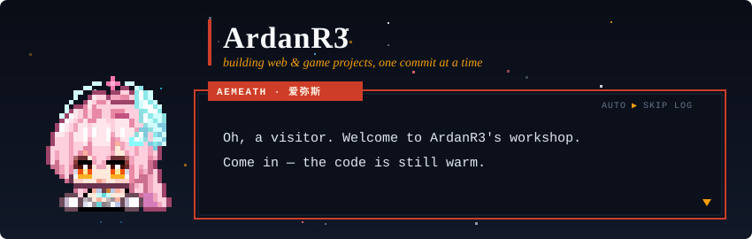
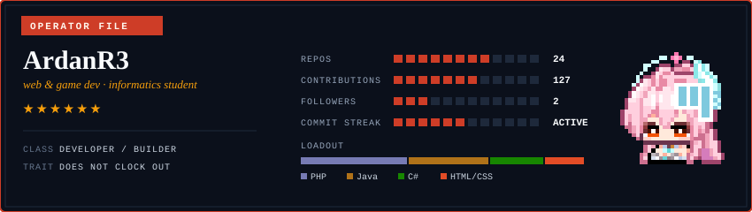

  
   
  
  
  

 

  

 

## 🔧 Arsenal

  

 

## 🌙 Night shift log

  
    
  
    
  <picture>
    <source media="(prefers-color-scheme: dark)" srcset="https://raw.githubusercontent.com/ArdanR3/ArdanR3/output/github-snake-dark.svg" />
    <source media="(prefers-color-scheme: light)" srcset="https://raw.githubusercontent.com/ArdanR3/ArdanR3/output/github-snake.svg" />
    
  </picture>

 

  <h3>🌸 <a href="https://anilist.co/user/ArdanR3/">Anilist watch list and reading list</a></h3>

  

    
<b>For anime watchers</b>

     
    
  

  

    
<b>For manga readers</b>

     
    
  

  

    
<b>For waifus simp</b>

     
    
  

 

## ✍️ House rules

> Ship small, ship often, and keep the repo clean.  
> If it works on localhost, document how to run it.  
> Always leave the codebase better than you found it.

  NIGHT SHIFT · ARDANR3 WORKSHOP
   
  

