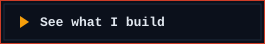
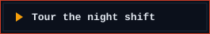
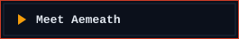
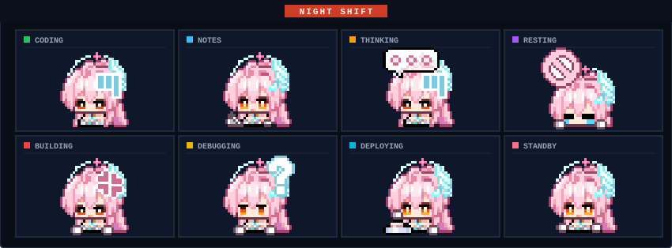

  
   
  
  
  

 

  

 

## 🏭 Now building

Building web applications, game prototypes, and sharpening software engineering fundamentals across **PHP**, **Java**, **C#**, and **HTML/CSS**.

<table>
  <tr>
    <td width="50%">
      
    </td>
    <td width="50%">
      
    </td>
  </tr>
  <tr>
    <td width="50%">
      
    </td>
    <td width="50%">
      
    </td>
  </tr>
</table>

 

## 🔧 Arsenal

  
   
  
  
  

 

## 🌙 Night shift log

  
    
  

 

## ✍️ House rules

> Ship small, ship often, and keep the repo clean.  
> If it works on localhost, document how to run it.  
> Always leave the codebase better than you found it.

  NIGHT SHIFT · ARDANR3 WORKSHOP
   
  

